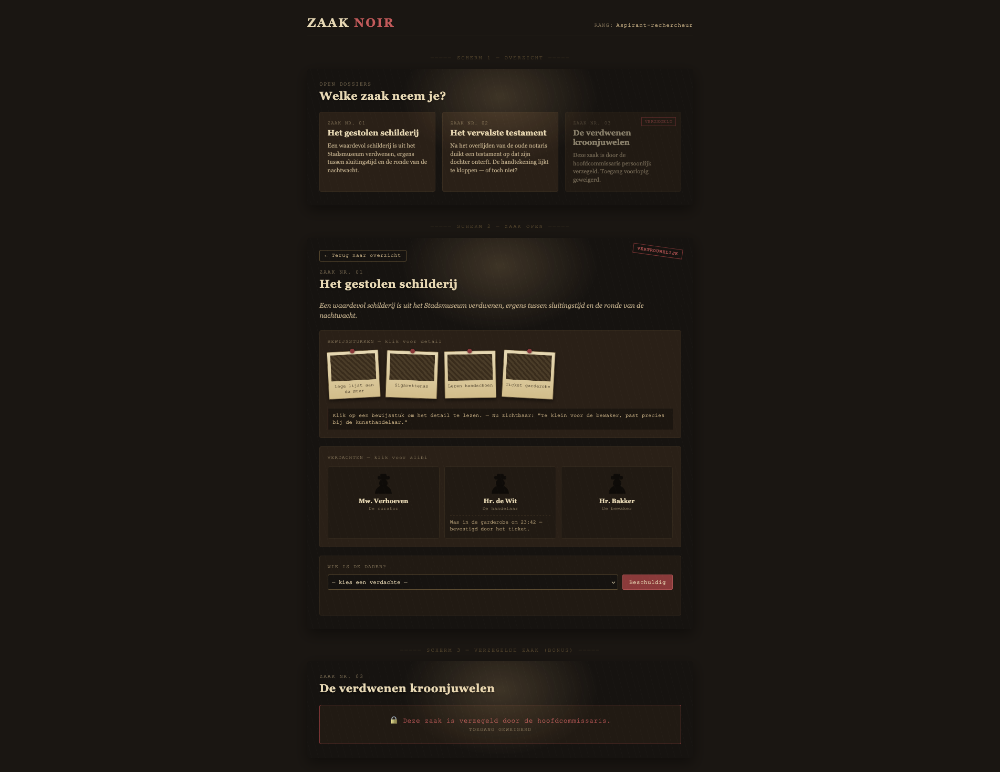

# Opdracht 12 – Zaak Noir

**Setup:**
```bash
cd opdracht-12-zaak-noir
npm install
npm run dev
```

---

## Opdracht 12 – Zaak Noir

> *Het is een regenachtige avond in de stad. Op je bureau ligt een stapel vochtige dossiers, de asbak is vol, en de hoofdcommissaris wil morgenochtend resultaten zien. Jij bent de rechercheur. De zaken wachten.*

Bouw een interactieve rechercheur-applicatie in klassieke film-noir stijl. De speler ziet een stapel open dossiers, kiest er een, bestudeert de bewijsstukken en verdachten, en wijst dan één verdachte aan als dader. Zit die keuze goed? Zaak gesloten. Zit die fout? Pech — het alibi klopt, zoek verder.

Het leuke zit in de details: bewijsstukken verschijnen pas als je erop klikt (alsof je een polaroid omdraait), alibi's komen pas uit de mond van een verdachte als je hem of haar aanspreekt, en elke zaak heeft precies één sluitend verhaal.

De zaken worden ingeladen uit een JSON-bestand (`public/data/zaken.json`) met `fetch()` in een `useEffect` — net zoals een echte applicatie later data van een server zou ophalen.

> 🎨 **Hoe moet het eruit zien?** Bekijk `preview.png` in deze folder voor een voorbeeld-design van alle schermen. De styling mag je zelf invullen, zolang de noir-sfeer er is.



**Wat ga je maken:**
- Een overzicht van openstaande zaken
- Een detailscherm per zaak met bewijsstukken en verdachten
- Klikbare bewijsstukken en verdachten (details verschijnen pas bij klik)
- Een formulier om een verdachte te beschuldigen

---

### Must Haves

**Zaken inladen**
- Haal de zaken op uit `public/data/zaken.json` met `fetch()` in een `useEffect`
- Toon een loading-melding zolang de data nog niet binnen is

**Zaak-overzicht**
- Toon alle zaken als kaarten met titel en beschrijving
- Klik op een kaart opent de detailweergave van die zaak

**Zaak-detail**
- Toon de titel en beschrijving van de geselecteerde zaak
- Toon alle bewijsstukken (alleen de naam)
- Toon alle verdachten (alleen naam en rol)
- Een knop "Terug naar overzicht"

**Bewijsstukken & verdachten**
- Klik op een bewijsstuk toont het detail (`detail`-veld)
- Klik op een verdachte toont het alibi (`alibi`-veld)
- Gebruik `useState` per kaart om de open/dicht-status bij te houden

**Beschuldiging**
- Een dropdown of knoppenrij met alle verdachten van de zaak
- Een "Beschuldig"-knop
- Vergelijk de gekozen verdachte met het `dader`-veld van de zaak
- Toon een passende melding: "Aangehouden! Zaak gesloten." of "Helaas — verkeerde verdachte."

**Design**
- Het design moet bij de noir-sfeer passen (donkere kleuren, serif-titels, een beetje regen of lampgloed mag)
- Zie `preview.png` in deze folder voor een voorbeeld — pak de sfeer over, maar maak het niet exact hetzelfde

---

### Bonus

Klaar met de must-haves? Werk aan één of meerdere van deze uitbreidingen:

**Verzegelde zaak**
- Een zaak met `verzegeld: true` in de JSON mag niet geopend worden
- Toon in plaats daarvan de melding "Deze zaak is verzegeld door de hoofdcommissaris"

**Foutafhandeling**
- Vang fouten in je `fetch()` netjes af met `.catch()` of `try/catch`
- Toon een duidelijke melding als het laden mislukt

**Rechercheur-rang**
- Houd het aantal opgeloste zaken bij in `localStorage`
- Toon een rang bovenin: 0 = "Aspirant-rechercheur", 1–2 = "Rechercheur", 3+ = "Hoofdinspecteur"
- De rang blijft staan na een refresh

**Schrijf je eigen zaak**
- Voeg een nieuw object toe aan `zaken.json` met dezelfde structuur (titel, beschrijving, dader, bewijsstukken, verdachten)
- Kijk of de applicatie hem zonder code-aanpassingen toont

**Theorie:**
- [React - useEffect & fetch](https://meesterjson.nl/cheat-sheet/pages/react/useeffect.html)
- [React - Conditionals](https://meesterjson.nl/cheat-sheet/pages/react/conditionals.html)
- [React - localStorage](https://meesterjson.nl/cheat-sheet/pages/react/localstorage.html)
- [React Cheat Sheet (overzicht)](https://meesterjson.nl/cheat-sheet/pages/react/index.html)

**Oplevering:** Commit & Push + link inleveren via Canvas
